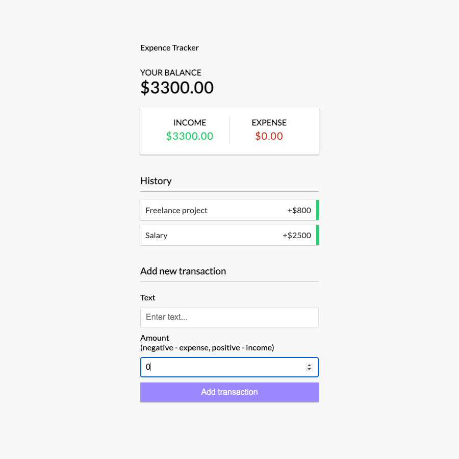

# Expense Tracker

A lightweight personal finance app for tracking income and expenses in real time. Add transactions, see your running balance, and review your history — all in a single-page React interface.

**[Live demo](https://exxpence-app.surge.sh)** · **[Source on GitHub](https://github.com/itsnoormuhammad/react-expense-app)**



## Features

- **Balance overview** — running total updated as you add transactions
- **Income vs expense breakdown** — positive amounts count as income, negative as expenses
- **Transaction history** — list of all entries with color-coded indicators
- **Add & delete** — create new transactions and remove them on hover
- **In-memory state** — data lives in React context (resets on page refresh)

## Tech Stack

| Layer | Technology |
| --- | --- |
| UI | React 16, JSX |
| State | Context API + `useReducer` |
| Styling | CSS (custom, no UI framework) |
| Tooling | Create React App, Yarn |
| Deployment | Surge (GitHub Actions CI/CD) |

## Getting Started

### Prerequisites

- Node.js 16+ (Node 17+ requires the legacy OpenSSL flag — see below)
- Yarn

### Install & run locally

```bash
git clone https://github.com/itsnoormuhammad/react-expense-app.git
cd react-expense-app
yarn install
yarn start
```

Open [http://localhost:3000](http://localhost:3000) in your browser.

### Build for production

```bash
yarn build
```

On Node 17+, if you hit an OpenSSL error, use:

```bash
NODE_OPTIONS=--openssl-legacy-provider yarn build
```

## Project Structure

```
src/
├── App.js                 # Root layout and provider
├── AppReducer.js          # Transaction reducer (add / delete)
├── context/
│   └── GlobalContext.js   # Shared state and actions
└── components/
    ├── Header.jsx
    ├── Balance.jsx
    ├── IncomeExpense.jsx
    ├── TransactionList.jsx
    ├── Transaction.jsx
    └── AddTransaction.jsx
```

## Deployment

The app deploys automatically to Surge on every push to `master` via GitHub Actions (`.github/workflows/surge_deploy.yml`). To redeploy manually:

```bash
yarn build
npx surge ./build your-domain.surge.sh
```

## License

MIT
